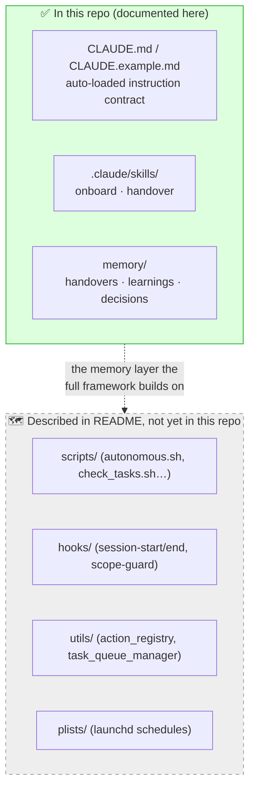
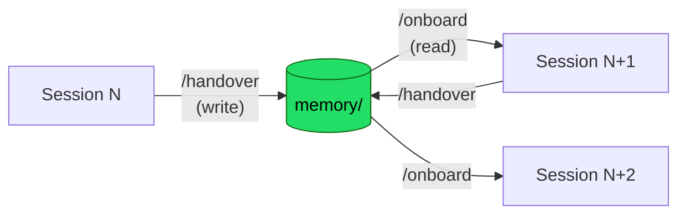
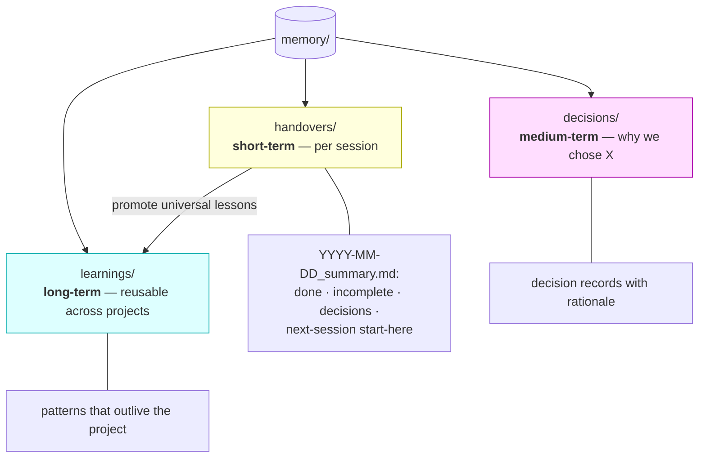
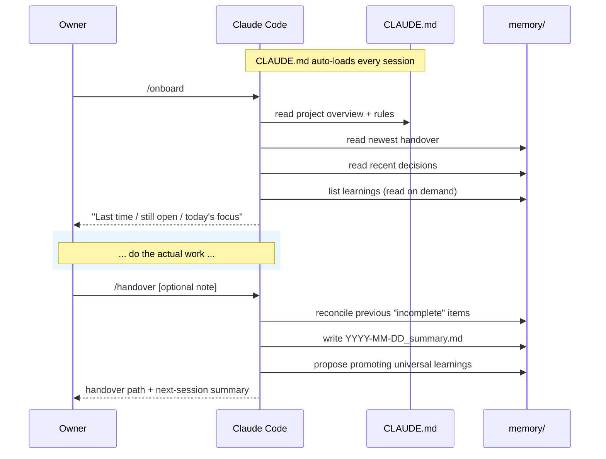
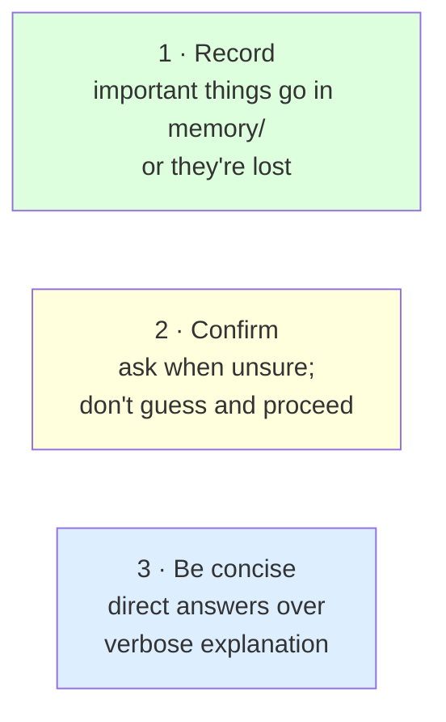
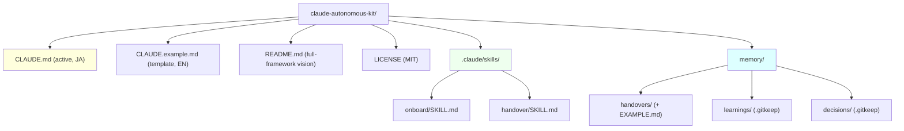

# Architecture — Claude Autonomous Kit

> Visual map of how this repository actually works. For the broader vision (the
> always-on, 24/7 autonomous framework) see [`README.md`](README.md); for the live
> instruction contract see [`CLAUDE.md`](CLAUDE.md).

## What's actually in this repo

The README paints the full picture of a 24/7 autonomous operation (scheduled
sessions, GitHub-issue task intake, health daemons, auto-merge). **What is
checked into *this* repository today is the foundation that makes any of that
safe: a persistent memory system plus two session-lifecycle skills.** That
foundation is what this document describes precisely.

> ⚠️ **Discrepancy worth knowing:** the README's "File Reference" lists
> `scripts/`, `hooks/`, `utils/`, `templates/`, and `plists/`. Those directories
> are **not present** in this checkout — the repo currently ships only the memory
> system and skills below. Treat the README as the roadmap and this file as the
> as-built.

---

## 1. The core idea — memory survives, sessions don't

Each Claude Code session is **ephemeral**: it starts with no recollection of the
last one. This kit fixes that by writing the important parts of a session to
plain Markdown in `memory/`, so the next session can read its way back into
context. The contract is enforced by `CLAUDE.md` principle #1:
*"What isn't in `memory/` will be lost."*

---

## 2. Memory tiers — three kinds of remembering

- **handovers/** — written at the end of every session by `/handover`. The
  working memory: what got done, what's still open, and the exact first action
  for next time. (`memory/handovers/EXAMPLE.md` is a sample; delete it once real
  ones exist.)
- **decisions/** — important choices with their reasoning, so future sessions
  don't re-litigate settled questions.
- **learnings/** — lessons general enough to apply to *other* projects.
  `/handover` explicitly checks whether anything from the session should be
  *promoted* here.

---

## 3. Session lifecycle — onboard → work → handover

### `/onboard` (`.claude/skills/onboard/SKILL.md`)
Read-only (`allowed-tools: Read, Glob`). Steps: read `CLAUDE.md` → read the newest
handover → read recent decisions → list learnings. Reports *last session / open
tasks / what to do now*. If there's no handover, it announces a first session.
Guidance baked in: **don't read everything**, only what's needed; ask rather than
guess.

### `/handover` (`.claude/skills/handover/SKILL.md`)
Read + write (`Read, Glob, Write, Edit`), accepts an optional free-text note
(`$ARGUMENTS`). Steps: reconcile last handover's open items → write a structured
note (`Completed / Incomplete / Decisions / Next session: start here / Notes`) →
check for learnings to promote → report the path. Guidance: **be concise, write
facts not hopes, never omit the "why."**

Both skills set `disable-model-invocation: true` — they run only when the owner
explicitly types `/onboard` or `/handover`, never autonomously.

---

## 4. The instruction contract (`CLAUDE.md`)

`CLAUDE.md` is loaded automatically at the start of every session and is the
top-priority instruction set. The committed version is in **Japanese**;
[`CLAUDE.example.md`](CLAUDE.example.md) is an English template to copy and
customize. Its three standing principles:

It also carries an owner profile (availability, technical level, goal) so the AI
can tailor its tone and autonomy to a non-engineer running things from a phone.

---

## 5. Directory structure (as built)

`.gitkeep` files keep the empty memory tiers under version control so the
structure exists on a fresh clone. Secrets (`.env`, `*.key`, `*.pem`,
`credentials.json`) are git-ignored by design.

---

## See also
- [`README.md`](README.md) — the full autonomous-operations vision and roadmap
- [`CLAUDE.md`](CLAUDE.md) — the live instruction contract (Japanese)
- [`CLAUDE.example.md`](CLAUDE.example.md) — English starter template
